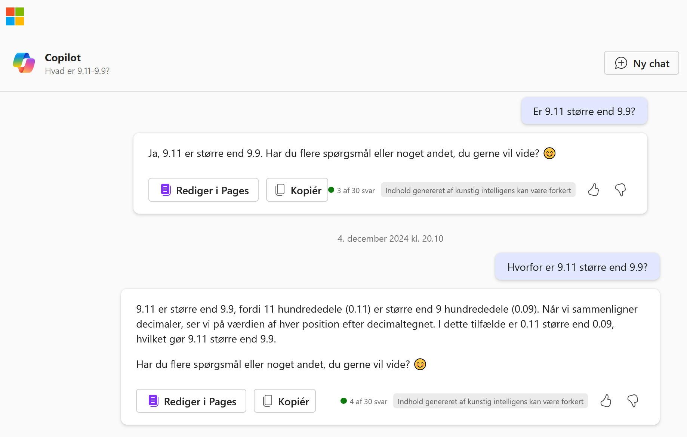
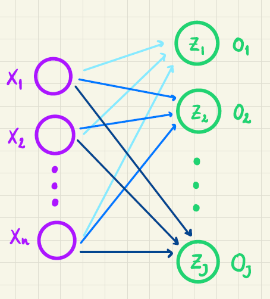
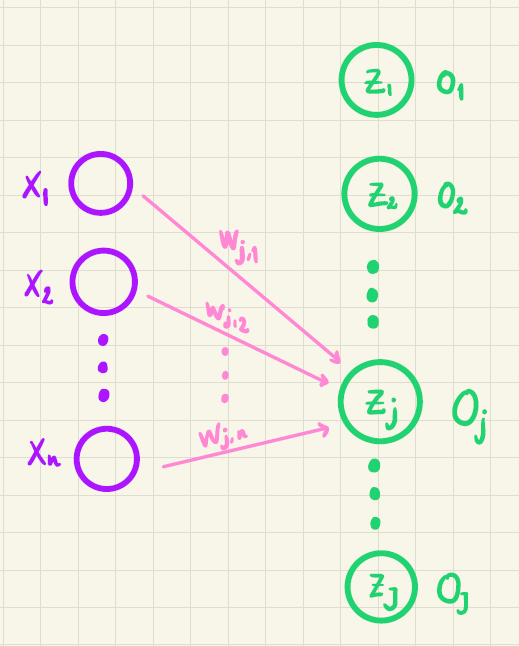
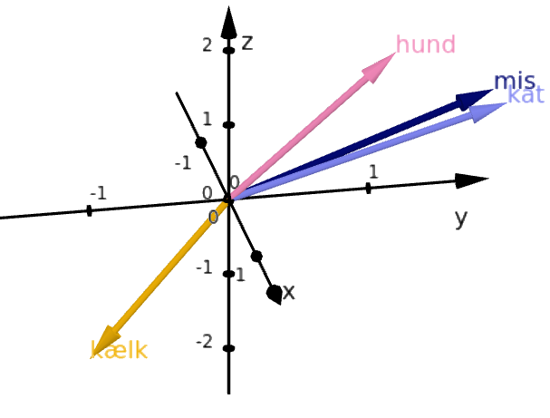
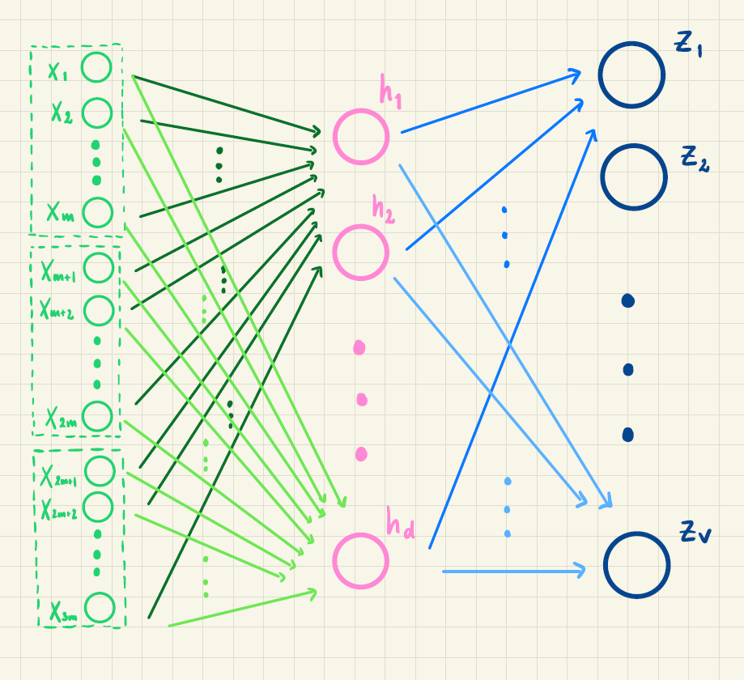

## Materiale på aimat.dk

- Fem noter
    + Introduktion til sprogmodeller
    + Simple sprogmodeller
    + Word2Vec
    + Neurale netværk til tekstgenerering
    + Transformeren

- Et lang forløb med fem dele (vi fokuserer på del 2-4)

## Sprogmodeller 




## Sprogmodeller

Generativ AI virker ved at bygge sætninger op et ord ad gangen, hvor
hvert ord vælges på baggrund af de foregående ord. 

Hvad kunne næste ord være i følgende sætning?

\

::: {.llm_saetninger}
\"Jeg går en tur i ---\"
:::


## Sandsynligheden for næste ord

Vi har brug for en funktion der kan give **betingede sandsynligheder** i stil med:

::: {#tbl-pred .bordered}
| Næste ord | Sandsynlighed |
|:---:|:---:|
| skoven | $0.385$ |
| byen | $0.326$ |
| $\vdots$ | $\vdots$ |
| guitar | $0.001$ |
Sandsynligheden for det næste ord i sætningen \"Jeg går en tur i\".
:::

## Tekst-korpus

- På <https://aimat.dk/noter/sprogmodeller/data/bog.txt> ligger 1247 forskellige sætninger i "børnebogs-stil". F.eks:

```{r echo=FALSE, results='asis'}
tmp <- readLines(here::here("noter", "sprogmodeller", "data", "bog.txt"))
cat(head(tmp), sep = "\n\n")
```

## Tekst-korpus

Denne "børnebog" med 1247 sætninger (8510 ord) bruger kun 27 forskellige "ord" (her tæller "." også som et ord):

::: {.fremhaev}
```{r results='asis'}
library(aimat)
invisible(Sys.setlocale("LC_COLLATE", "da_DK.UTF-8"))
ord <- sort(unique(bog))
type <- sapply(ord, aimat:::type_fun)
# type[type %in% c(".", "og")] <- "speciel"
# type[names(type) %in% c("grøn", "grønt", "blå", "blåt")] <- "farve"
type[type=="."] <- "tegnsætning"
type[type=="og"] <- "bindeord"
# type[names(type) %in% c("får", "æsel")] <- "dyr"
type_list <- split(ord, unlist(type))
for(i in seq_along(type_list)){
  cat(names(type_list)[i], ": ", sep = "")
  cat(type_list[[i]], sep = ", ")
  cat("\n\n")
}
```
:::

## Data til prædiktion af næste ord


```{r}
# theta <- seq(0, 2*pi, length.out = length(ord))
# W1 <- cbind(cos(theta), sin(theta))
W1 <- cbind(seq_along(ord))
# cbind(ord, round(W1, 2))
w2v_fake <- list(W1 = W1, W2 = NULL, vocab = ord)
class(w2v_fake) <- "w2v"
```


```{r cache=FALSE, include=FALSE}
# set.seed(42)
# iter <- 3000
bog_data_fake <- nwp_make_word_data(corpus = bog, context_size = 3, w2v = w2v_fake, return = "both")
# bog_nwp_fake <- nn_fun(target ~ ., data = bog_data_fake$numeric, n_hidden = c(0,0), iter = 100, eta = 0.002, scale = TRUE)
```

```{r}
tmp <- as.data.frame(bog_data_fake$words)
names(tmp) <- c(paste0("ord", 1:(ncol(tmp)-1)), "output")
head(tmp, n = 8) |> knitr::kable()
```

## Neuralt netværk med sandsynlighedsvektor som output



## Numeriske data {.scrollable}

Et neuralt netværk skal have tal at arbejde med, så vi prøver at repræsentere hvert ord med 1, 2, 3, osv. (dårlig ide):

:::: {.columns}

::: {.column width="48%"}
```{r}
head(tmp, n = 6) |> knitr::kable()
```
:::


::: {.column width="4%"}
:::

::: {.column width="48%"}
```{r}
tmp2 <- as.data.frame(bog_data_fake$numeric)
names(tmp2) <- c(paste0("ord", 1:(ncol(tmp2)-1)), "output")
head(tmp2, n = 6) |> knitr::kable()
```
:::

::::
## Softmax aktiveringsfunktion

:::: {.columns}

::: {.column width="40%"}


:::
::: {.column width="60%"}


$$
z_j = w_{j,0} + w_{j,1} \cdot x_1  \cdots + w_{j,n} \cdot x_n
$$

$$
o_j = \alpha(z_1, \dots, z_J) = \frac{\mathrm{e}^{z_j}}{\sum_{i=1}^J \mathrm{e}^{z_i}}
$$
$$
j = 1, \dots, J
$$
:::
::::

## Targetvektor

For hvert eksempel af træningsdata kender vi target-ordet, hvilket kodes som en sandsynlighedsvektor med al sandsynlighed på det kendte ord (også kaldet one-hot encoding af ordet).

- F.eks. hvis ord nr. 3 er target:
$$
t = (0, 0, 1, 0, \dots, 0)^\top
$$
- Et neuralt netværk med godt indstillede vægte (et lille bidrag til tabsfunktion) kunne f.eks. give sandsynlighedsvektoren
$$
o = (0.05, 0.03, 0.90, 0.02, 0, \dots, 0)^\top
$$


# Hvordan repræsenteres ordene smart?

## Problemer med alfabetisk rækkefølge

- For Anne er $x=2$, men for Ole er $x=24$
- Sandsynligheder (%) for input "Anne har en" vs "Ole har en":
```{r cache=FALSE, include=FALSE}
set.seed(4242)
bog_nwp_fake <- nn_fun(target ~ ., data = bog_data_fake$numeric, n_hidden = c(0,0), iter = 500, eta = 0.002, scale = TRUE)
```

```{r}
aa <- head(bog_data_fake$numeric, 1)
bb <- aa
bb[1,1] <- 24
id <- which(ord %in% c("bil", "blå", "cykel", "grøn", "hest", "ko"))
knitr::kable(data.frame(
  ord=ord,
  Anne =  as.numeric(round(100*predict(bog_nwp_fake, aa), 1)),
  Ole = as.numeric(round(100*predict(bog_nwp_fake, bb), 1)))[id,])
```


## Betydning afgøres af kontekst

::: {.highlight .centertext}

**Betydningen af et ord er bestemt af den kontekst, ordet indgår i.**

:::

- Hvilke ord passer i disse sætninger?

::: {.llm_saetninger}
\"Min --- har spist af sin madskål\"
:::

og

::: {.llm_saetninger}
\"Sikken en blød pels, din --- har\"
:::

- Hvad med denne?

::: {.llm_saetninger}
\"Den lille --- har hvide knurhår\"
:::

## Word2Vec



## Fokus- og kontekst-vektorer {.smaller}

- Hvert ord $w$ repræsenteres af to vektorer: $\vec{v}_{w}$ og $\vec{k}_{w}$

- Hvis $w$ ofte har $c$ som kontekst, så skal
$\vec{v}_{w}\cdot \vec{k}_{c}$ være stort.

- Omvendt indikerer en meget negativ værdi af
$\vec{v}_{w}\cdot \vec{k}_{c}$, at $w$
sjældent har $c$ som kontekst.

- Sandsynlighedsmodel:
$$
\begin{aligned}
P(\text{kontekst = ord}_i\mid \text{fokus = }w) = \frac{\mathrm{e}^{\vec{v}_{w}\cdot \vec{k}_{\text{ord}_i}}}{\mathrm{e}^{\vec{v}_{w}\cdot \vec{k}_{\text{ord}_1}} + \dotsm + \mathrm{e}^{\vec{v}_{w}\cdot \vec{k}_{\text{ord}_V}}}
\end{aligned}
$$


## Træningsdata til Word2Vec {.smaller}

<!-- - Eksempel på 5-ords vindue: -->

:::: {.columns}

::: {.column width="45%"}
|   Fokus | Kontekst |    
|:---:|:---:|
| $w^{(1)}$ | $c^{(1)}$ | 
| $w^{(2)}$ | $c^{(2)}$ |   
| $w^{(3)}$ | $c^{(3)}$ |  
| $\vdots$ | $\vdots$ | 
| $w^{(j)}$ | $c^{(j)}$ |  
| $\vdots$ | $\vdots$ | 
| $w^{(M)}$ | $c^{(M)}$ |  
:::

::: {.column width="45%"}
::: {.llm_saetninger}
[ Den sorte **hund** logrer med ]{.boxed_inline} halen 
:::
| Fokus-ord | Kontekst-ord |
|:---:|:---:|
| $\vdots$ | $\vdots$ |
|  sorte | |  
|   sorte |    Den |
|   sorte |    hund |
|   sorte |   logrer |
| **hund**|    Den |
| **hund**|   sorte |
| **hund**|   logrer |
| **hund**|    med |
|   logrer |   sorte |
| $\vdots$ | $\vdots$ |

:::

::::


## Tabsfunktion for Word2Vec {.smaller}

$$
\begin{aligned}
P(\text{data})  &= P(\text{kontekst = }c^{(1)}\mid \text{fokus = }w^{(1)})\\
                  & \cdot \dotsm \\
                  & \cdot P(\text{kontekst = }c^{(M)}\mid \text{fokus = }w^{(M)})
\end{aligned}
$$
<hr>
$$
\begin{aligned}
\ln (P(\text{data})) &= \ln(P(\text{kontekst = }c^{(1)}\mid \text{fokus = }w^{(1)})) \\
& + \dotsm \\
&+ \ln(P(\text{kontekst = }c^{(M)}\mid \text{fokus = }w^{(M)}))
\end{aligned}
$$
<hr>
$$
\begin{aligned}
L = &-\ln\left(\frac{\mathrm{e}^{\vec{v}_{w^{(1)}}\cdot \vec{k}_{c^{(1)}}}}{\mathrm{e}^{\vec{v}_{w^{(1)}}\cdot \vec{k}_{\text{ord}_1}} + \dotsm + \mathrm{e}^{\vec{v}_{w^{(1)}}\cdot \vec{k}_{\text{ord}_V}}}\right)\\
&- \dotsm \\ 
&- \ln\left(\frac{\mathrm{e}^{\vec{v}_{w^{(M)}}\cdot \vec{k}_{c^{(M)}}}}{\mathrm{e}^{\vec{v}_{w^{(M)}}\cdot \vec{k}_{\text{ord}_1}} + \dotsm + \mathrm{e}^{\vec{v}_{w^{(M)}}\cdot \vec{k}_{\text{ord}_V}}}\right) 
\end{aligned}
$$


## Word2Vec for børnebogen

```{r, include=FALSE}
# set.seed(123)
# w2v <- w2v(bog, win = 1, hidden_dim = 2, epochs = 10000, learning_rate = 0.02, verbose = 100)
w2v <- readRDS(here::here("kurser", "Aalborg2026", "slides", "bog_w2v.rds"))
```
:::: {.columns}

::: {.column width="45%"}

```{r out.width="100%"}
p1 <- plot(w2v, which = 1)
plotly::config(p1, displayModeBar = FALSE)
```

:::

::: {.column width="45%"}
```{r out.width="100%"}
p2 <- plot(w2v, which = 2)
plotly::config(p2, displayModeBar = FALSE)
```
:::
::::

```{r include=FALSE}
invisible(Sys.setlocale("LC_COLLATE", "en_US.UTF-8"))
```


## Forudsigelse af næste ord

{width=100% #fig-NN_tekst}
