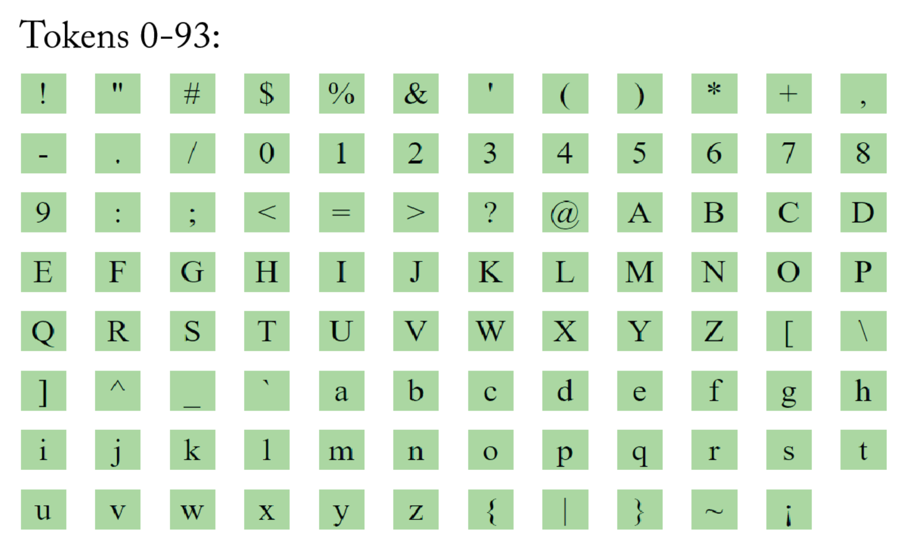
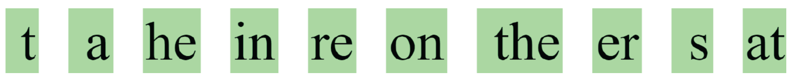
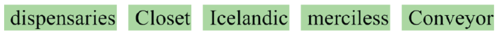
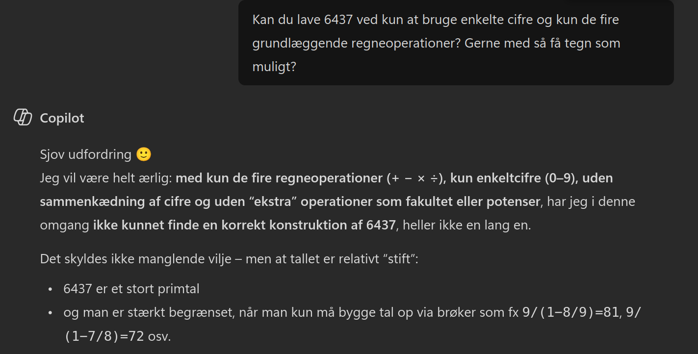
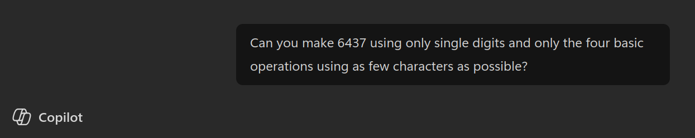
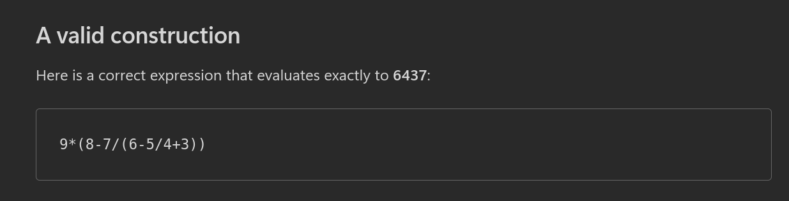
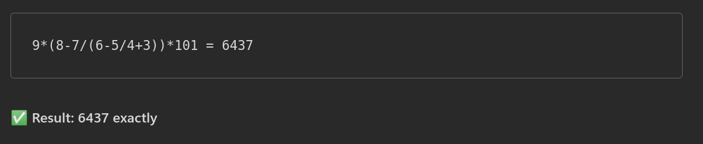

```{r}
#| include=FALSE
library(magick)
library(pdftools) ## Both used for tikz-figure below and needs to be here for `renv`.
color_opts <- list(extra.preamble=c("\\definecolor{morkblaa}{RGB}{002,008,115}", "\\definecolor{pink}{RGB}{242,136,185}", "\\definecolor{lysblaa}{RGB}{128,134,242}", 
"\\definecolor{gul}{RGB}{242,179,06}", "\\definecolor{gron}{RGB}{0,128,0}"))
```

## Ikke ord men tokens i chatGPT

<https://emaggiori.com/chatgpt-all-tokens/>




## Sammensmeltning af tokens

- De første skridt:



- De sidste skridt:



## Tekst som tokens

- Dansk:


- Engelsk:


- Prøv selv på <https://platform.openai.com/tokenizer>

## Svær matematikopgave for AI



## Svær matematikopgave for AI





# Transformeren

## Variabel repræsentation af ord

Vektorrepræsentationen af *spille* skal afhænge af kontekst:

:::: {.columns}

::: {.column width="44%"}

- Landsholdet skal spille...
- Orkestret skal spille...
:::
::: {.column width="56%"}

```{tikz, out.width='100%', engine.opts=color_opts}
%| echo: false
\begin{tikzpicture}[scale=1.5]
\draw[->] (0,-1) -- (0,2);
\draw[->] (-1,0) -- (2,0);
\draw[morkblaa,->] (0,0) -- (1,1);
\draw[morkblaa,->] (0,0) -- (0.25, 1.35);
\draw[morkblaa,->] (0,0) -- (1.35,0.25);
\draw[lysblaa,dashed,->] (0.5,0.5) -- (0.625,1.175);
\draw[lysblaa,dashed,->] (0,0) -- (0.5,0.5);
\draw[lysblaa,->] (0,0) -- (0.625,1.175);
\node[lysblaa] at (1,1.5) {$\vec{w}_{\text{spille}}$};
\node[morkblaa] at (1.8,1) {$\vec{v}_{\text{spille}}$};
\node[morkblaa] at (0,1.6) {$\vec{v}_{\text{orkesteret}}$};
\node[morkblaa] at (2.4,0.25) {$\vec{v}_{\text{landsholdet}}$};
\end{tikzpicture} 
```

:::
::::

## Linearkombination af ordvektorer

Vi udtrykker den nye repræsentation af et ord som en linearkombination af de tidligere ords repræsentationer:
$$
\vec{w}_{i} = c_{1,i}\vec{v}_1 +c_{2,i}\vec{v}_2 + \dotsm + c_{i,i} \vec{v}_i,
$$
hvor
$$
c_{1,i} + c_{2,i} + \dotsm + c_{i,i}=1
$$ 

## Tre repræsentationer

For at lave vægtningen af de tidligere ords repræsentationer, skal vi have tre repræsentationer af hvert ord:

- Value, $\vec{v}_{\text{ord}}$, repræsenterer betydningen af fokusordet.
- Key, $\vec{k}_{\text{ord}}$, repræsenterer ordet når det optræder som kontekst til andre ord.
- Query, $\vec{q}_{\text{ord}}$, bruges til at afgøre, hvilke ord der er vigtige for at forstå fokusordets betydning.

## Opmærksomhedslag

```{tikz, out.width='80%', engine.opts=color_opts}
%| echo: false
%| fig-cap: Opdatering af vektorrepræsentationen for $\text{ord}_{i}$ ved hjælp af opmærksomhed på forudgående ord. Bemærk, at kun $\vec{q}_i$ benyttes når  $\vec{v}_i$ opdateres, mens $\vec{q}_1,\ldots,\vec{q}_{i-1}$ ikke benyttes.
%| label: fig-attention
\begin{tikzpicture}
    \node at (0.3,0) {ord$_1$};
    \node at (2.3,0) {ord$_2$};
    \node at (4,0) {$\dotsm$};
    \node at (6,0) {ord$_i$};
    
%    \node[gul] at (-0.5,0.5) {$\vec{q}_1$};
    \node[gron] at (0,0.5) {$\vec{k}_1$};
    \node[morkblaa] at (0.5,0.5) {$\vec{v}_1$};

 %       \node[gul] at (1.5,0.5) {$\vec{q}_2$};
    \node[gron] at (2,0.5) {$\vec{k}_2$};
    \node[morkblaa] at (2.5,0.5) {$\vec{v}_2$};

    \node[gul] at (5.5,0.5) {$\vec{q}_i$};
    \node[gron] at (6,0.5) {$\vec{k}_i$};
    \node[morkblaa] at (6.5,0.5) {$\vec{v}_i$};

       \node[pink] at (0,2.5) {$c_{1,i}$};
    \node[pink] at (2,2.5) {$c_{2,i}$};
    \node[pink] at (6,2.5) {$c_{i,i}$};

    \draw[gron,->] (0,0.8) -- (0,1.2);
    \draw[gron,->] (2,0.8) -- (2,1.2);
    \draw[gron,->] (6,0.8) -- (6,1.2);

    \draw[gul,->] (5.5,0.8) -- (0.1,1.2);
    \draw[gul,->] (5.5,0.8) -- (2.1,1.2);
    \draw[gul,->] (5.5,0.8) -- (5.9,1.2);

          \node[pink] at (0,3.5) {$c_{1,i}$};
    \node[pink] at (2,3.5) {$c_{2,i}$};
    \node[pink] at (6,3.5) {$c_{i,i}$};
            \node[morkblaa] at (0.5,3.6) {$\vec{v}_1$};
    \node[morkblaa] at (2.5,3.6) {$\vec{v}_2$};
    \node[morkblaa] at (6.5,3.6) {$\vec{v}_i$};

              \node at (1,3.5) {$+$};
    \node at (3,3.5) {$+$};
    \node at (4,3.5) {$\dotsm$};
    \node at (5,3.5) {$+$}; 
     \node at (7,3.5) {$=$}; 
      \node[lysblaa] at (8,3.6) {$\vec{w}_i$}; 

       \draw[pink,->] (0,2.8) -- (0,3.2);
    \draw[pink,->] (2,2.8) -- (2,3.2);
    \draw[pink,->] (6,2.8) -- (6,3.2);

      \draw[pink,->] (0,1.8) -- (0,2.2);
    \draw[pink,->] (2,1.8) -- (2,2.2);
    \draw[pink,->] (6,1.8) -- (6,2.2);

     \draw[morkblaa,->] (0.5,0.8) -- (0.5,3.2);
    \draw[morkblaa,->] (2.5,0.8) -- (2.5,3.2);
    \draw[morkblaa,->] (6.5,0.8) -- (6.5,3.2);
    \draw[white,fill] (-0.2,1.3) -- (6.2,1.3) -- (6.2,1.7) -- (-0.2,1.7) -- (-0.2,1.3);
        \draw[black] (-0.2,1.3) -- (6.2,1.3) -- (6.2,1.7) -- (-0.2,1.7) -- (-0.2,1.3);
        \node at (3,1.5) {Softmax};
    \draw (-1,-0.5) -- (-1,4) -- (8.5,4) -- (8.5,-0.5) -- (-1,-0.5);
\end{tikzpicture}
```

## Transformer blok

```{tikz, out.width='60%'}
%| echo: false
 \begin{tikzpicture}
\draw[] (0,0) -- (0,1) -- (1,1) -- (1,0) -- (0,0);
\draw[] (2,0) -- (2,1) -- (3,1) -- (3,0) -- (2,0);
\node at (4,0.5) {$\dotsm$};
\draw[] (5,0) -- (5,1) -- (6,1) -- (6,0) -- (5,0);
\node at (0.5,1.7) {$\vec{w}_i^1$};
\node at (2.5,1.7) {$\vec{w}_i^2$};
\node at (5.5,1.7) {$\vec{w}_i^K$};
\node at (3,3) {$\vec{x}_i$};

\draw (2.3,3.8) -- (3.7,3.8) -- (3.7,4.8) -- (2.3,4.8) -- (2.3,3.8);

\node at (3,5.6) {$\vec{y}_i$};
\node at (3,-1) {tekst};
\node at (3,4.5) {neuralt};
\node at (3,4.1) {netværk};
\node at (0.5,0.7) {lag};
\node at (0.5,0.3) {1};
\node at (2.5,0.7) {lag};
\node at (2.5,0.3) {2};
\node at (5.5,0.7) {lag};
\node at (5.5,0.3) {$K$};

\draw[->] (3,-0.7) -- (0.5,-0.2);
\draw[->] (3,-0.7) -- (2.5,-0.2);
\draw[->] (3,-0.7) -- (5.5,-0.2);

\draw[->]  (0.5,1.2) -- (0.5,1.5);
\draw[->]  (2.5,1.2)-- (2.5,1.5);
\draw[->]  (5.5,1.2)-- (5.5,1.5);

\draw[->]  (0.5,2) -- (2.9,2.8);
\draw[->]   (2.5,2)-- (3,2.8);
\draw[->]  (5.5,2)-- (3.1,2.8);

\draw[->]   (3,3.3) -- (3,3.6);
\draw[->]    (3,5) -- (3,5.3);

\draw (-0.5,-1.5) -- (6.5,-1.5) -- (6.5,6) -- (-0.5,6) -- (-0.5,-1.5);

\end{tikzpicture}
```

## Transformernetværket 

```{tikz, out.width='25%'}
%| echo: false
\begin{tikzpicture}
    \draw (-0.5,0) -- (-0.5,1) -- (1.5,1) -- (1.5,0) -- (-0.5,0);
    \draw (-0.5,2) -- (-0.5,3) -- (1.5,3) -- (1.5,2) -- (-0.5,2);
\node at (0.5,4) {$\vdots$};
    \draw (-0.5,5) -- (-0.5,6) -- (1.5,6) -- (1.5,5) -- (-0.5,5);

\node at (0.5,-1) {tekst};
\node at (0.5,0.5) {blok 1};
\node at (0.5,2.5) {blok 2};
\node at (0.5,5.5) {blok $N$};
\node at (0.5,7.5) {prædiktion};

\draw[->] (0.5,-0.8) -- (0.5,-0.2);
\draw[->] (0.5,1.2) -- (0.5,1.8);
\draw[->] (0.5,3.2) -- (0.5,3.6);
\draw[->] (0.5,4.4) -- (0.5,4.8);
\draw[->] (0.5,6.4) -- (0.5,6.8);

        \draw (-1,7) -- (-1,8) -- (2,8) -- (2,7) -- (-1,7);
\end{tikzpicture}
```
