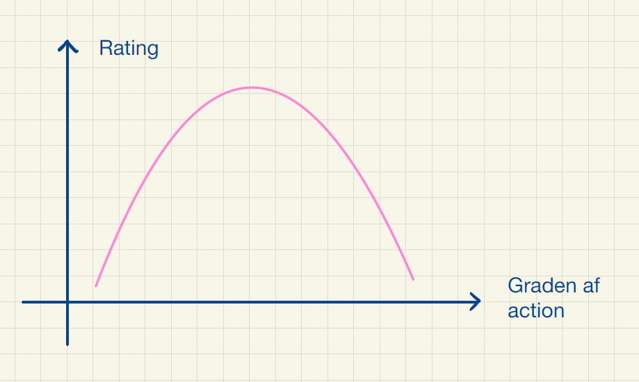
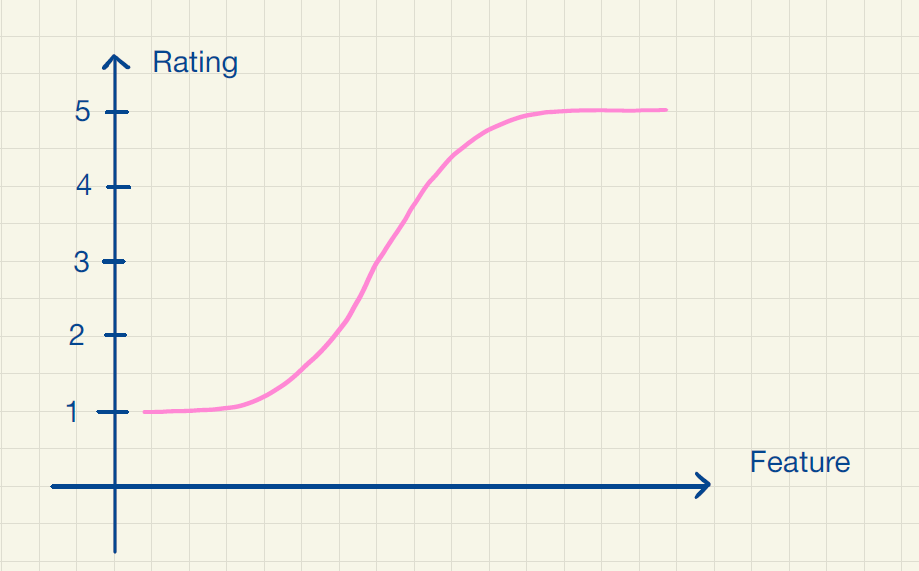

## Hvad skal du se på Netflix?

{style='float:left;' width='40%'}

- Oplægget her bruger noten [Anbefalingssystemer](https://aimat.dk/noter/anbefalinger/anbefalinger.html)

- Bagefter skal vi prøve (dele af) forløbet [Hvad skal du se på Netflix?](https://aimat.dk/undervisningsforlob/anbefalingssystemer.html)

## Typer af anbefalingssystemer

- *Samarbejdsbaseret* (Collaborative filtering):
    + Adfærd sammenlignes med andre.
    + Anbefales noget baseret på lignende brugere.

- *Indholdsbaseret* (Content based filtering):
    + Profil for hver bruger, der beskriver, hvilken type indhold, brugeren godt kan lide.
    + Anbefales noget af samme type.

## En samarbejdsbaseret algoritme

- I noten er der en simpel algoritme baseret på betingede sandsynliger.

- God træning i at udregne betingede sandsynligheder og genopfriske definitionen.

- Udelades i vores gennemgang i dag.

## Indholdsbaseret algoritme til ratings

- Forestil dig de gode gamle dage, hvor streamingtjenester brugte ratings med 1-5 stjerner...

- Vi ønsker at forudsige den enkelte brugers rating ud fra egenskaber (features) ved filmen.

- Simple eksempler på features:
    + $x_1$: Hvor mange procent af filmen er kærlighedsscener.
    + $x_2$: Hvor mange procent af filmen er actionscener.

## Multipel lineær regression

- Prædiktion af brugerrating $r$ for film med features $x_1$ og $x_2$:
$$ \hat{r}=b + a_1x_1 + a_2x_2.$$

- Vi kalder $b$, $a_1$ og $a_2$ brugerens *vægte* (parametre).
    + $b$ rating af film uden action og kærlighed
    + $a_i$ ændring i rating ved ændring fra $x_i$ til $x_i+1$ med alt andet uændret.
    
- Generelt:
$$\hat{r} = b+ a_{1}x_{1} + a_{2}x_{2} + \dotsm + a_{M}x_{M}$$

## Data til estimation af vægte

::: {.bordered}
|        | $x_1$ | $x_2$ | Rating |
|:------:|:-----:|:-----:|:------:|
| Film 1 |   0   |  40   |   4    |
| Film 2 |  10   |  50   |   5    |
| Film 3 |  10   |  10   |   1    |
| Film 4 |  30   |   0   |   1    |
:::

## Estimation af vægte

- Tabsfunktion baseret på $\hat{r}_{j} = b+a_{1}x_{1j} + a_{2}x_{2j}$:
$$E= (r_{1}-\hat{r}_{1})^2 + (r_{2}-\hat{r}_{2})^2 + \dotsm + (r_N-\hat{r}_N)^2,$$

- Partielle afledede kan findes og sættes lig nul:
$$
\begin{aligned}
&\frac{\partial E}{\partial a_i} = -2x_{i1}(r_1-\hat{r}_1) - \dotsm -2x_{iN}(r_N-\hat{r}_N) = 0\\ \\
&\frac{\partial E}{\partial b} = - 2(r_1-\hat{r}_1) - \dotsm  - 2(r_N-\hat{r}_N) = 0
\end{aligned}
$$ 

## Mere fleksible modeller

:::: {.columns}

::: {.column width="48%"}
- Feature engineering

:::
::: {.column width="48%"}
- Neurale netværk

:::
::::

## Samarbejdsbaserede modeller for ratings

- Multipel lineær regressionsmodel var kun for en enkelt bruger. 

- Samarbejdsbaseret tilgang udnytter viden om hvordan andre brugere
har ratet filmene. 

- Vi kigger på model baseret på matrixfaktorisering, som stammer fra 2006 udgaven af konkurrencen "The Nexflix Prize".

## Data

::: {#tbl-rates .bordered}
|          | Film 1 | Film 2 | Film 3 |
|:--------:|:------:|:------:|:------:|
| Bruger 1 |   1    |   NA   |   4    |
| Bruger 2 |   2    |   NA   |   5    |
| Bruger 3 |   3    |   3    |   1    |
| Bruger 4 |   NA   |   NA   |   1    |

Eksempel på datasæt over brugeres ratings på en skala fra 1 til 5. NA
angiver, at brugeren ikke har set filmen.
:::

## Matrixfaktorisering

- Vi indfører $M$ *featurevægte* $x_{1j},\ldots,x_{Mj}$ for hver film $j=1,\dots,p$.
- Den $i$te brugers præferencer for de $M$ features beskrives ved *præferencevægtene* $a_{i1},\ldots,a_{iM}$ for $i=1,\dots,n$.
- Vi modellerer så $i$te brugers rating af $j$te film ved:

$$
\hat{r}_{ij} = a_{i1}x_{1j} + a_{i2}x_{2j} + \dotsm + a_{iM}x_{Mj}
$$

- Vi bruger altså $M\cdot p + M\cdot n$ vægte til at modellere $n\cdot p$ ratings.

## Kaldes matrixfaktorisering fordi

- Modellen er $\hat{R} = AX$ i matrixform:

$$
\begin{bmatrix} \hat{r}_{11} & \hat{r}_{12} & \cdots & \hat{r}_{1p}\\
 \hat{r}_{21} & \hat{r}_{22} & \cdots & \hat{r}_{2p}\\
  \vdots & \vdots &  & \vdots\\
   \hat{r}_{n1} & \hat{r}_{n2} & \cdots & \hat{r}_{np}\\
\end{bmatrix}
= 
\begin{bmatrix} a_{11} & \cdots & a_{1M}\\
 a_{21} & \cdots & a_{2M}\\
  \vdots &  & \vdots\\
   a_{n1} & \cdots & a_{nM}\\
\end{bmatrix}
\begin{bmatrix} x_{11} & x_{12} & \cdots & x_{1p}\\
  \vdots & \vdots &  & \vdots\\
   x_{M1} & x_{M2} & \cdots & x_{Mp}\\
\end{bmatrix}
$$

- En "low-rank" approksimation med latente variable.

## Estimation af vægte

- Tabsfunktion:
 $$E=\sum_{r_{ij} \neq NA} (r_{ij}-\hat{r}_{ij})^2 $$ 
 
- Gradientnedstigning vha. partielle afledede:
$$
\begin{aligned}
\frac{\partial }{\partial a_{im}} (r_{ij}-\hat{r}_{ij})^2 = -2 (r_{ij}-\hat{r}_{ij})x_{mj}\\
\frac{\partial }{\partial x_{mj}} (r_{ij}-\hat{r}_{ij})^2 = -2 (r_{ij}-\hat{r}_{ij})a_{im}
\end{aligned}
$$

## Moderne anbefalingssystemer

- En blanding af samarbejdsbaseret og indholdsbaseret.

- Rækkefølge bliver vigtig.

- Transformer-baserede modeller.

## Hands-on

- [aimat.dk > undervisningsforløb > Hvad skal du se på Netflix?](https://aimat.dk/undervisningsforlob/anbefalingssystemer.html)

- Elevtid: 2 x 90 min

- Jeres tid: 45 min

- Vi springer over opgave 1-3 i første omgang. I kan vende tilbage hvis I får tid.
